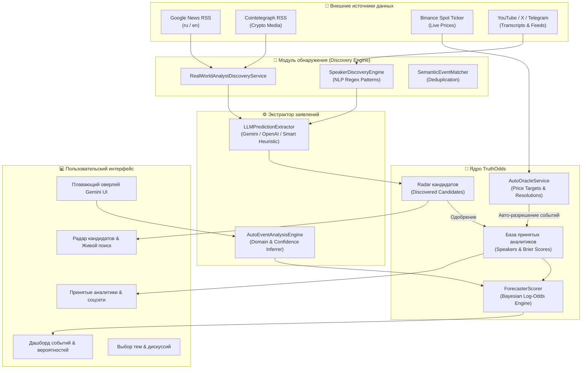

<div align="center">

# 🔮 TruthOdds

### Автономная платформа вероятностной оценки событий, калибровки аналитиков и мониторинга мировых медиа

[](https://www.python.org/)
[](https://fastapi.tiangolo.com/)
[](https://sqlite.org/)
[](https://tailwindcss.com/)
[](#-тестирование)
[](LICENSE)

*Интеллектуальная система, которая собирает прогнозы реальных экспертов из мировых СМИ и соцсетей, оценивает их персональную калибровку и точность через **Brier Score** и рассчитывает объективную вероятность будущих событий на основе **Байесовской агрегации**.*

[Ключевые возможности](#-ключевые-возможности) •
[Математический аппарат](#-математический-аппарат) •
[Архитектура](#-архитектура-системы) •
[Быстрый старт](#-быстрый-старт) •
[API Документация](#-api-эндпоинты) •
[Тестирование](#-тестирование)

---

</div>

## 🌟 Ключевые возможности

### 📡 1. Радар кандидатов & Живой поиск в мировых медиа (`RealWorldAnalystDiscoveryService`)
* **Автономное сканирование открытых новостных потоков**:
  * Прямая интеграция с **Google News RSS** (мультиязычный: автоматическое переключение на русскую или международную ленту).
  * Прямой мониторинг криптоизданий (**Cointelegraph**, **CoinDesk**, **Bits Media**, **BeInCrypto**), деловых СМИ (**CNBC**, **Yahoo Finance**, **Bloomberg**, **Forbes**) и **РБК**.
  * Работает полностью **без платных API-ключей**.
* **Интеллектуальное извлечение реальных экспертов**:
  * Алгоритмическое распознавание имен аналитиков по контекстным маркерам и паттернам заявлений (*Arthur Hayes, Cathie Wood, Peter Brandt, Tom Lee, Роберт Кийосаки, Александр Герчик, Michael Saylor*).
  * Фильтрация нерелевантных сущностей (регуляторы, биржи, общие термины).
* **Автоматическое извлечение прогнозов**:
  * Определение формулировки события, горизонта времени, числовой уверенности спикера (от 5% до 95%) и точной цитаты.
  * Прямая кликабельная ссылка на исходную статью первоисточника.
* **Байесовский импорт в один клик**:
  * Кнопка **«Одобрить и учесть прогнозы»** автоматически переводит персону в принятые аналитики, создает соответствующие события и мгновенно пересчитывает апостериорные шансы.

---

### 🧠 2. Автономный расчет событий по запросу (`AutoEventAnalysisEngine`)
* **Плавающий оверлей ввода в стиле Google Gemini**:
  * Позволяет задать любой вопрос или тему (например: *«Биткоин достигнет $150,000 к концу 2026 года»*, *«ФРС снизит ключевую ставку летом 2026»*, *«OpenAI запустит полноценный AGI до 2027»*).
* **Умный авто-тег сферы**:
  * Семантический классификатор на русском и английском языках автоматически категоризирует тему (`🪙 Криптовалюты`, `📈 Макроэкономика`, `🤖 Технологии & AI`, `🌐 Общее`).
* **Семантическая дедупликация**:
  * Система сравнивает новые запросы с существующими событиями через токенизацию ключевых сущностей, предотвращая дублирование схожих рыночных тем.
* **Автоматический учет мнений**:
  * Анализирует заявления спикеров по ключевым словам и мгновенно вычисляет расчетную вероятность без ручной настройки.

---

### 🔮 3. Авто-Оракул рыночных котировок (`AutoOracleService`)
* **Сверка спотовых цен в реальном времени**:
  * Прямой оракул котировок Binance Spot API (**BTC, ETH, SOL, XRP, DOGE, ADA, BNB, AVAX, LINK, SUI**).
* **Парсер ценовых таргетов**:
  * Автоматически распознает условия вида `BTC reaches $120,000`, `ETH выше 5000 USDT`, `Solana упадет ниже 100`.
* **Фоновый мониторинг исходов**:
  * Встроенный воркер сверяет статус активных событий с ценами биржи, завершает события при достижении таргета (`RESOLVED_TRUE` / `RESOLVED_FALSE`) и обновляет **Brier Score** каждого участвовавшего аналитика.

---

### 💬 4. Кластеризация нарративов и дискуссий (`NarrativeCluster`)
* **Инкубатор формирующихся тем**:
  * Анализирует публичные споры, группируя высказывания экспертов по тематическим кластерам.
  * Градация зрелости: **Формируется** (1–2 спикера) $\rightarrow$ **Готова к событию** (3+ экспертов) $\rightarrow$ **Событие создано**.
* **Двухколоночный интерактивный режим**:
  * Выбор темы из списка слева с детальным просмотром аргументов, цитат спикеров и кнопкой моментального перевода в отслеживаемое событие.

---

### 🎨 5. Современный интерфейс Gemini UI
* **Правило концентрических радиусов скругления** (гармоничная геометрия: внешние блоки `rounded-3xl`, вложенные карточки `rounded-2xl`, внутренние кнопки `rounded-xl`).
* **Живой тикер спотовых цен криптовалют** в верхней панели.
* **Интерактивные фильтры и чипы сфер**: фильтрация событий, дискуссий и аналитиков по сферам в один клик.
* **Плавающая капсула быстрого ввода** внизу экрана.
* **Модальные окна с детальным разбором формул** и закрытием по клику вне окна.

---

## 📐 Математический аппарат

### 1. Персональный рейтинг аналитика (Brier Score)
Калибровка эксперта рассчитывается строго на основе свершившихся фактов:

$$BS = \frac{1}{N} \sum_{i=1}^N (f_i - o_i)^2$$

* $f_i \in [0.01, 0.99]$ — уверенность спикера в прогнозе.
* $o_i \in \{0, 1\}$ — фактический исход события (1 — сбылось, 0 — не сбылось).
* **0.00** — безупречная пророческая точность.
* **0.25** — уровень случайного угадывания (монетка 50/50).
* **> 0.25** — отрицательная полезность (систематический оверконфиденс или индикатор обратного действия).

---

### 2. Сглаживание веса доверия (Bayesian Shrinkage)
Для защиты от искажений при малом объеме статистики (например, у аналитика с 1 случайным попаданием из 1) применяется регуляризация:

$$W_i = \frac{M \cdot W_0 + N \cdot \text{RawCredibility}}{M + N}$$

где:
* $W_0 = 0.5$ — базовый априорный вес доверия.
* $M = 3$ — псевдонаблюдения регуляризатора.
* $N$ — количество разрешенных прогнозов эксперта.
По мере накопления реальных результатов вес $W_i$ асимптотически сходится к объективной калибровке спикера.

---

### 3. Байесовская агрегация в логарифмических шансах (Log-Odds Aggregation)
При наличии нескольких высказываний по одному событию мнения объединяются в пространстве логитов:

$$L_{\text{posterior}} = L_{\text{base}} + \sum_{i=1}^K w_i \cdot \left( L_i - L_{\text{base}} \right)$$

$$P_{\text{итог}} = \frac{1}{1 + e^{-L_{\text{posterior}}}}$$

* Голос признанного эксперта с высокой калибровкой ($W_i \approx 0.85$) существенно корректирует вероятность.
* Шумные заявления кликбейтных авторов с низким рейтингом ($W_i \le 0.30$) демпфируются и практически не влияют на расчет.

---

## 🏗 Архитектура системы



---

## 📂 Структура проекта

```text
ProjPlatf/
├── app/
│   ├── api/                    # REST API эндпоинты FastAPI
│   │   ├── discovery.py        # Радар, живой поиск в медиа, кластеры дискуссий
│   │   ├── events.py           # События, вероятности, ручное и авто-разрешение
│   │   ├── oracle.py           # Спотовые котировки Binance и проверка таргетов
│   │   ├── speakers.py         # Лидерборд аналитиков, соцсети, калибровка
│   │   ├── statements.py       # Заявления и цитаты спикеров
│   │   ├── sources.py          # Мониторинг каналов
│   │   ├── crypto_seed.py      # Демо-данные Топ-10 авторов и событий
│   │   └── demo.py             # Сброс базы данных и демо-состояния
│   ├── database/               # Сессия SQLAlchemy и миграции SQLite
│   ├── discovery/              # Модули обнаружения
│   │   ├── real_world_discovery.py # Живой поиск в мировых СМИ и RSS
│   │   ├── speaker_discovery.py    # Извлечение авторов из транскриптов
│   │   └── event_discovery.py      # Кластеризация дискуссий в нарративы
│   ├── engine/                 # Математические алгоритмы
│   │   ├── scoring.py          # Brier Score, Shrinkage, Байесовская агрегация
│   │   ├── auto_analysis.py    # Авто-разбор тем, классификатор сфер
│   │   └── clustering.py       # Семантическое сопоставление событий
│   ├── extractor/              # Извлечение прогнозов (LLM + эвристика)
│   ├── ingestion/              # Парсинг YouTube транскриптов и XML RSS
│   ├── models/                 # SQLAlchemy сущности (Speaker, Event, Statement, Candidate)
│   ├── oracles/                # Оракул Binance и парсер ценовых таргетов
│   ├── services/               # Бизнес-логика системы прогнозов
│   ├── templates/              # HTML-шаблон дашборда (Tailwind CSS, Gemini UI)
│   ├── config.py               # Конфигурация Pydantic Settings
│   └── main.py                 # Точка входа приложения, CORS, Background Lifespan
├── tests/                      # Модульные и интеграционные тесты (Pytest)
│   ├── test_api.py             # Тесты REST API и разрешения событий
│   ├── test_crypto_features.py # Тесты оракула Binance, таргетов и семантики
│   ├── test_discovery.py       # Тесты живого поиска в медиа и радара
│   └── test_scoring.py         # Тесты математики Brier Score и Байеса
├── requirements.txt            # Зависимости проекта
├── truth_odds.db               # База данных SQLite
└── README.md                   # Документация проекта
```

---

## 🚀 Быстрый старт

### 1. Клонирование репозитория
```bash
git clone https://github.com/your-username/truth-odds.git
cd truth-odds
```

### 2. Создание и активация виртуального окружения
```bash
# Windows
python -m venv .venv
.\.venv\Scripts\activate

# Linux / macOS
python3 -m venv .venv
source .venv/bin/activate
```

### 3. Установка зависимостей
```bash
pip install -r requirements.txt
```

### 4. Запуск приложения
```bash
python -m uvicorn app.main:app --host 127.0.0.1 --port 8000 --reload
```

После старта перейдите в браузере:
* 🖥 **Интерактивный дашборд:** [http://127.0.0.1:8000](http://127.0.0.1:8000)
* 📖 **Swagger API документация:** [http://127.0.0.1:8000/docs](http://127.0.0.1:8000/docs)
* 📄 **ReDoc спецификация:** [http://127.0.0.1:8000/redoc](http://127.0.0.1:8000/redoc)

---

## 🧪 Тестирование

Все ключевые математические формулы, алгоритмы извлечения, интеграции с медиа и оракулами покрыты автоматическими тестами:

```bash
python -m pytest tests/ -v
```

**Результат выполнения тест-сьюта (24 теста):**
```text
tests/test_api.py::test_health_check PASSED                              [  4%]
tests/test_api.py::test_seed_demo_and_verify_scoring PASSED              [  8%]
tests/test_api.py::test_event_resolution_updates_speaker_ratings PASSED  [ 12%]
tests/test_api.py::test_delete_event_and_narrative PASSED                [ 16%]
tests/test_api.py::test_speaker_x_social_presence PASSED                 [ 20%]
tests/test_api.py::test_topic_auto_verification PASSED                   [ 25%]
tests/test_crypto_features.py::test_semantic_event_matching_deduplication PASSED [ 29%]
tests/test_crypto_features.py::test_crypto_oracle_price_target_parser PASSED [ 33%]
tests/test_crypto_features.py::test_seed_crypto_top10 PASSED             [ 37%]
tests/test_crypto_features.py::test_auto_oracle_endpoints PASSED         [ 41%]
tests/test_crypto_features.py::test_automated_event_analysis_and_forecasting PASSED [ 45%]
tests/test_discovery.py::test_speaker_name_extraction PASSED             [ 50%]
tests/test_discovery.py::test_narrative_clustering_and_auto_promotion PASSED [ 54%]
tests/test_discovery.py::test_candidate_discovery_and_manual_approval PASSED [ 58%]
tests/test_discovery.py::test_seed_radar_demo PASSED                     [ 62%]
tests/test_discovery.py::test_real_world_analyst_search_and_bayesian_integration PASSED [ 66%]
tests/test_discovery.py::test_real_world_live_media_scan PASSED          [ 70%]
tests/test_scoring.py::test_brier_score_perfect PASSED                   [ 75%]
tests/test_scoring.py::test_brier_score_random_fifty_fifty PASSED        [ 79%]
tests/test_scoring.py::test_brier_score_worst PASSED                     [ 83%]
tests/test_scoring.py::test_credibility_shrinkage PASSED                 [ 87%]
tests/test_scoring.py::test_bayesian_aggregation_high_credibility PASSED [ 91%]
tests/test_scoring.py::test_bayesian_aggregation_low_credibility_ignored PASSED [ 95%]
tests/test_scoring.py::test_bayesian_aggregation_consensus PASSED        [100%]

======================== 24 passed in 3.01s ========================
```

---

## 📡 API Эндпоинты

| Метод | Эндпоинт | Описание |
| :--- | :--- | :--- |
| `GET` | `/api/events` | Получить список всех отслеживаемых событий с Байесовскими вероятностями |
| `POST` | `/api/events` | Создать новое событие или задачу для анализа |
| `POST` | `/api/events/{id}/resolve` | Разрешить исход события (TRUE / FALSE) с обновлением Brier Score авторов |
| `GET` | `/api/speakers` | Список принятых аналитиков, их калибровка, Brier Score и соцсети |
| `POST` | `/api/discovery/radar/search-person` | Живой поиск реального аналитика в мировых медиа (Google News, Cointelegraph) |
| `POST` | `/api/discovery/radar/live-scan` | Автономное сканирование медиалент на предмет новых экспертов и прогнозов |
| `GET` | `/api/discovery/candidates` | Список кандидатов, обнаруженных радаром |
| `POST` | `/api/discovery/candidates/{id}/approve` | Одобрить кандидата и автоматически перенести его прогнозы в систему |
| `POST` | `/api/discovery/candidates/{id}/reject` | Отклонить кандидата |
| `GET` | `/api/discovery/narratives` | Список кластеров дискуссий и нарративов |
| `POST` | `/api/discovery/narratives` | Создать нарратив с авто-проверкой оракулом |
| `GET` | `/api/oracle/crypto-prices` | Текущие спотовые цены Binance (BTC, ETH, SOL и др.) |
| `POST` | `/api/oracle/trigger-check` | Принудительная сверка активных событий со спотовым оракулом |
| `POST` | `/api/demo/reset-database` | Полная очистка базы данных |

---

## ⚙️ Переменные окружения (Опционально)

По умолчанию в платформе работает высокоэффективный эвристический экстрактор и классификатор, не требующий внешних платных сервисов. При желании использовать нейросетевую обработку через LLM, создайте файл `.env`:

```env
# База данных (по умолчанию локальный SQLite)
DATABASE_URL=sqlite:///./truth_odds.db

# Название приложения
APP_NAME=TruthOdds

# Google Gemini API (опционально, для сложного NLP-анализа)
GEMINI_API_KEY=your_gemini_api_key_here

# OpenAI API (альтернативно)
OPENAI_API_KEY=your_openai_api_key_here
```

---

## 📜 Лицензия

Проект распространяется под открытой лицензией [MIT License](LICENSE). Вы можете свободно использовать, модифицировать и распространять данный код.
